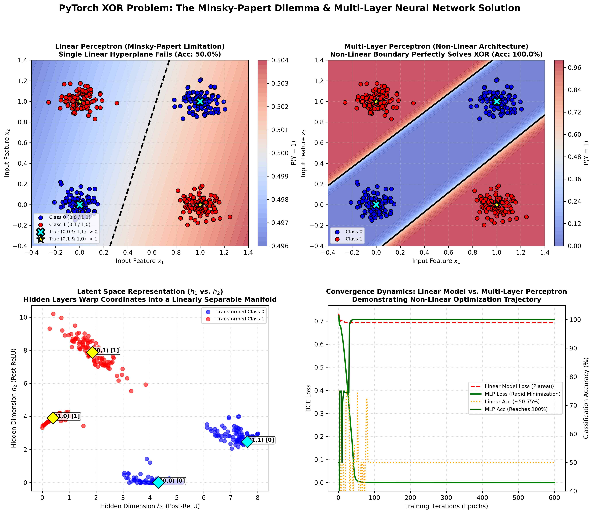

# Solving the Classic XOR Problem with Neural Networks in PyTorch

[](https://pytorch.org/)
[](https://opensource.org/licenses/MIT)
[](https://www.python.org/)
[]()
[]()

An end-to-end, mathematically rigorous PyTorch implementation solving the foundational **Exclusive-OR (XOR)** problem. 

This project demonstrates the historical and theoretical breakthrough that overcame the **Minsky & Papert (1969) Perceptron Limitation**: proving why single-layer linear models mathematically fail on non-linearly separable truth tables ($50\%$ accuracy, loss plateauing at $\ln(2) \approx 0.6931$), and how multi-layer perceptrons (MLPs) with non-linear activations warp the coordinate space into a linearly separable latent manifold to achieve **$100\%$ classification accuracy** and **$0.0000$ binary cross-entropy loss**.

---

## Visual Diagnostic Overview

The 4-panel diagnostic dashboard below illustrates the complete geometric and optimization analysis of the XOR problem:



---

## Table of Contents

- [Visual Diagnostic Overview](#visual-diagnostic-overview)
- [Mathematical Formulation & The Minsky-Papert Dilemma](#mathematical-formulation--the-minsky-papert-dilemma)
  - [1. The XOR Truth Table & Geometry](#1-the-xor-truth-table--geometry)
  - [2. Mathematical Proof of Linear Inseparability](#2-mathematical-proof-of-linear-inseparability)
  - [3. The Multi-Layer Latent Space Transformation](#3-the-multi-layer-latent-space-transformation)
  - [4. Binary Cross-Entropy Loss & Optimization](#4-binary-cross-entropy-loss--optimization)
- [Comparative Experimental Benchmark](#comparative-experimental-benchmark)
  - [Truth Table Evaluation](#truth-table-evaluation)
  - [Ablation Metrics Table](#ablation-metrics-table)
- [Neural Network Architectures](#neural-network-architectures)
  - [Single-Layer Linear Perceptron](#single-layer-linear-perceptron)
  - [Multi-Layer Perceptron (MLP)](#multi-layer-perceptron-mlp)
- [Project Directory Structure](#project-directory-structure)
- [Installation & Reproduction](#installation--reproduction)
- [Author & License](#author--license)

---

## Mathematical Formulation & The Minsky-Papert Dilemma

### 1. The XOR Truth Table & Geometry

The Exclusive-OR (XOR) logic gate outputs true ($1$) if and only if its two binary inputs differ:

| $x_1$ | $x_2$ | $y = x_1 \oplus x_2$ | Class Category |
| :---: | :---: | :---: | :---: |
| $0$ | $0$ | **$0$** | Class 0 (Negative) |
| $0$ | $1$ | **$1$** | Class 1 (Positive) |
| $1$ | $0$ | **$1$** | Class 1 (Positive) |
| $1$ | $1$ | **$0$** | Class 0 (Negative) |

Plotting these coordinates on the Euclidean plane $\mathbb{R}^2$ places identical labels on opposite diagonals: $(0,0)$ and $(1,1)$ belong to Class 0, while $(0,1)$ and $(1,0)$ belong to Class 1.

### 2. Mathematical Proof of Linear Inseparability

A single-layer perceptron defines a decision boundary as an affine hyperplane:

$$
w_1 x_1 + w_2 x_2 + b = 0
$$

To correctly classify all four XOR points, the weights $(w_1, w_2)$ and bias $b$ must simultaneously satisfy the following four strict linear inequalities:

1. For $(0, 0) \to 0$: $w_1(0) + w_2(0) + b < 0 \implies \mathbf{b < 0}$
2. For $(0, 1) \to 1$: $w_1(0) + w_2(1) + b > 0 \implies \mathbf{w_2 + b > 0}$
3. For $(1, 0) \to 1$: $w_1(1) + w_2(0) + b > 0 \implies \mathbf{w_1 + b > 0}$
4. For $(1, 1) \to 0$: $w_1(1) + w_2(1) + b < 0 \implies \mathbf{w_1 + w_2 + b < 0}$

Summing inequalities (2) and (3) yields:

$$
(w_1 + b) + (w_2 + b) > 0 \implies w_1 + w_2 + 2b > 0
$$

Substituting $w_1 + w_2 + b < 0$ from inequality (4):

$$
(w_1 + w_2 + b) + b > 0 \implies (\text{negative quantity}) + b > 0 \implies b > 0
$$

This directly contradicts inequality (1), which states $\mathbf{b < 0}$. 

$$\therefore \text{No linear decision boundary exists that can separate the XOR function.}$$

This fundamental proof by Marvin Minsky and Seymour Papert in 1969 triggered the historical "first AI winter," lasting until the widespread adoption of multi-layer architectures and gradient backpropagation.

### 3. The Multi-Layer Latent Space Transformation

An MLP overcomes this geometric impasse by passing inputs through intermediate hidden layers equipped with non-linear activation functions $\sigma(\cdot)$ (such as ReLU: $\max(0, z)$):

$$
\mathbf{h} = \text{ReLU}(\mathbf{W}_1 \mathbf{x} + \mathbf{b}_1)
$$

The non-linear activation bends and folds the 2D input space into a transformed latent representation $\mathbf{h} \in \mathbb{R}^d$. As visualized in **Panel 3** of our diagnostic artifact, the hidden units project $(0,0)$ and $(1,1)$ to one side of the latent manifold, while $(0,1)$ and $(1,0)$ are positioned such that a final linear hyperplane can cleanly separate them:

$$
\hat{y} = \sigma(\mathbf{w}_2^T \mathbf{h} + b_2)
$$

### 4. Binary Cross-Entropy Loss & Optimization

The network is optimized using Binary Cross-Entropy (BCE) with logits:

$$
\mathcal{L}_{\text{BCE}}(z, y) = \max(z, 0) - z \cdot y + \log(1 + e^{-|z|})
$$

When a linear model is forced to fit XOR, it is restricted to predicting the empirical prior probability $P(Y=1) \approx 0.5$ for all coordinates. At this point, BCE loss plateaus at its theoretical minimum for random guessing:

$$
\mathcal{L} = -\log(0.5) = \ln(2) \approx \mathbf{0.6931}
$$

In contrast, our MLP reduces BCE loss to **$0.0000$**.

---

## Comparative Experimental Benchmark

### Truth Table Evaluation

Evaluation of both models on the canonical discrete 4-point XOR truth table:

| Input $(x_1, x_2)$ | True Label | Linear Perceptron $P(Y=1)$ | Linear Status | MLP $P(Y=1)$ | MLP Status |
| :---: | :---: | :---: | :---: | :---: | :---: |
| $(0, 0)$ | **$0$** | $0.4988$ | Correct | **$0.0000$** | **Correct** |
| $(0, 1)$ | **$1$** | $0.4978$ | **Failed** | **$1.0000$** | **Correct** |
| $(1, 0)$ | **$1$** | $0.5022$ | Correct | **$1.0000$** | **Correct** |
| $(1, 1)$ | **$0$** | $0.5013$ | **Failed** | **$0.0000$** | **Correct** |

### Ablation Metrics Table

| Architecture | Parameters | Final BCE Loss | Truth Table Accuracy | 400-Point Cluster Accuracy |
| :--- | :---: | :---: | :---: | :---: |
| **Single-Layer Perceptron (Linear)** | $3$ | $0.6931$ $(\approx \ln 2)$ | **$50.0\%$** | **$50.0\%$** |
| **Multi-Layer Perceptron (Non-Linear)** | $25$ | **$0.0000$** | **$100.0\%$** | **$100.0\%$** |

---

## Neural Network Architectures

### Single-Layer Linear Perceptron

```
Input [B, 2] ──► Linear(2 -> 1) ──► Sigmoid ──► Output [B, 1]
(Total parameters: 2 weights + 1 bias = 3)
```

### Multi-Layer Perceptron (MLP)

```
Input [B, 2]
     │
     ▼ Linear(2 -> 4) + ReLU
Hidden Layer 1 [B, 4]
     │
     ▼ Linear(4 -> 2) + ReLU
Latent Coordinate Space [B, 2]
     │
     ▼ Linear(2 -> 1) + Sigmoid
Predicted Probability [B, 1]
(Total parameters: (2x4 + 4) + (4x2 + 2) + (2x1 + 1) = 12 + 10 + 3 = 25)
```

---

## Project Directory Structure

```plaintext
12_xor_neural_network/
│
├── xor_neural_network_analysis.png        # 4-panel diagnostic visual artifact
├── main.py                               # Complete model, training, and visualization script
├── .gitignore                            # Git ignore configuration
└── README.md                             # Mathematical proofs and benchmark documentation
```

---

## Installation & Reproduction

### Prerequisites

```bash
# Clone the repository
git clone https://github.com/GideonMwiti/pytorch-xor-neural-network.git
cd pytorch-xor-neural-network

# Install dependencies
pip install torch numpy matplotlib
```

### Run the Experiment

Execute the self-contained script:

```bash
python main.py
```

The script will:
1. Generate the continuous 400-sample XOR distribution.
2. Train the Single-Layer Linear Perceptron (observing the 50% accuracy ceiling).
3. Train the Multi-Layer Perceptron (observing 100% convergence and zero loss).
4. Evaluate both models on the canonical discrete truth table.
5. Export the publication-quality diagnostic figure `xor_neural_network_analysis.png`.

---

## Author & License

This project is part of the **100 PyTorch Projects in 10 Days** challenge.

- **Author**: Gideon Mwiti
- **GitHub**: [@GideonMwiti](https://github.com/GideonMwiti)
- **License**: MIT

